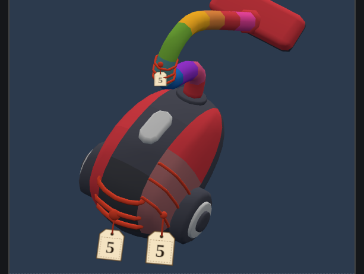

# Overview

- Mỗi một piece trong game, ở bất kì layer nào, có thể bị **khóa** (Visual chốt
sau), không nhìn thấy màu. Mỗi khóa này có một số đi kèm ban đầu (có thể visual dưới dạng tag hoặc gì
đó). Mỗi khi có một box được hoàn thành thì khóa này sẽ được mở, hiện ra piece
đang ở bên dưới.

- Việc dùng booster để clear box cũng sẽ tính vào số lượng của khóa.

# Demo

::: {style='text-align:center'}

<iframe src="play.html" width="900" height="800"></iframe>
:::

# Công thức độ khó

- Các piece bị chứa trong khóa sẽ được cộng số lượng miếng chặn theo số lượng còn
lại trên khóa
- Các khóa sẽ tạo thêm điều kiện để làm đầy hàng chờ người chơi. Tuy nhiên, nếu
  random màu thì việc này cũng không đảm bảo được. Cần playtest thêm.

